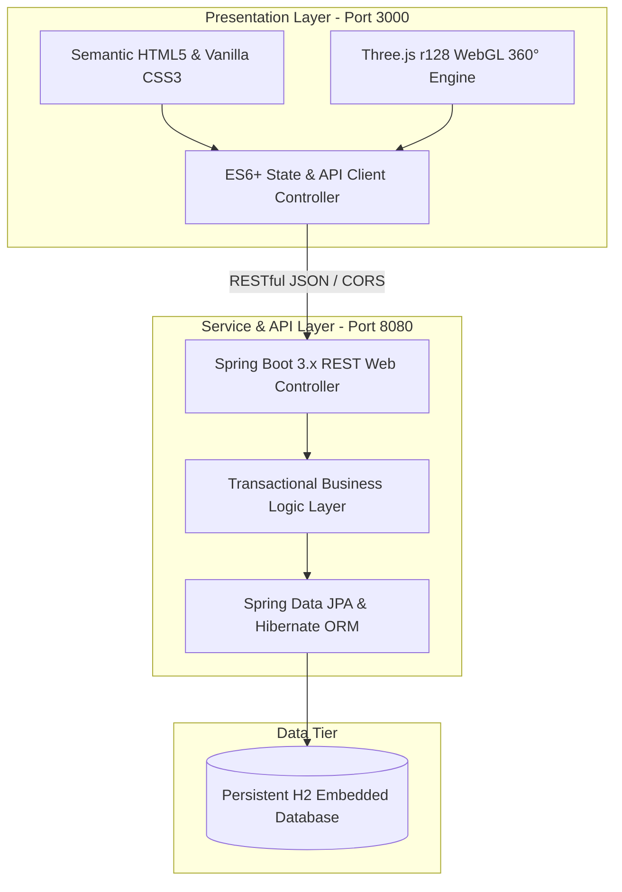

<div align="center">

  

  # TORO — Luxury Hotels & Resorts
  ### India Collection • Next-Generation Hospitality Platform

  <p align="center">
    <a href="https://skillicons.dev">
      
    </a>
  </p>

  <p align="center">
    <strong>A full-stack, enterprise-grade luxury hospitality booking and property management system (PMS) featuring photorealistic 360° WebGL virtual tours, dynamic state/destination inventory filtering across India, transparent luxury inclusions, and high-performance Spring Boot microservices.</strong>
  </p>

  [Key Features](#-key-features) •
  [Business Model & Wealth Generation](#-business-model--wealth-generation-usp) •
  [Architecture](#-system-architecture) •
  [API Endpoints](#-rest-api-documentation) •
  [Developer Quickstart](#-developer-quickstart) •
  [Roadmap](#-future-roadmap)
</div>

---

## 📖 Executive Summary

The global luxury hospitality industry is undergoing a digital revolution. Traditional Online Travel Agencies (OTAs) charge hotels between **15% to 25% in commission fees** while delivering static, photo-filtered room cards that create skepticism, high bounce rates, and post-booking regret.

**TORO** addresses this market gap by delivering an **experiential, disintermediated direct-booking platform**:
1. **Spatial Confidence**: Guests inspect every room in true **360° interactive virtual reality** before paying, eliminating booking hesitation.
2. **Curated Regional Sanctuaries**: Fine-tuned for India's high-net-worth tourism corridors (Goa, Mumbai, Udaipur, Jaipur, Manali, Kerala Backwaters, and Rishikesh).
3. **Transparent Inclusions ("The Stuffs")**: Itemized breakdown of artisanal mattresses, Egyptian cotton bedding, Forest Essentials toiletries, and private butler services.
4. **Autonomous Property Management**: Real-time staff management portal monitoring revenue, room turnover, and on-demand concierge ticket dispatch.

---

## 💡 Unique Selling Proposition (USP) & Wealth Generation

```
┌────────────────────────────────────────────────────────────────────────┐
│                        HOW TORO GENERATES WEALTH                       │
├─────────────────────────┬────────────────────────┬─────────────────────┤
│ 1. Direct Booking Alpha │ 2. Ancillary Upsells   │ 3. SaaS White-Label │
│ Saves 15-25% OTA cuts   │ Curated luxury add-ons │ Enterprise licensing│
│ per transaction.        │ (Spa, Yachts, Dining). │ to boutique resorts.│
└─────────────────────────┴────────────────────────┴─────────────────────┘
```

### 1. Direct Booking Disintermediation (15–25% Cost Recovery)
* **Problem**: A ₹10,000/night booking on traditional OTAs loses ₹1,500–₹2,500 directly in commissions.
* **TORO Solution**: By providing an immersive 360° virtual tour and transparent room inspection, TORO converts guests directly on the brand's website, restoring 100% of room gross margins.

### 2. Immersive Conversion Rate & Premium ADR Elevation
* Interactive 360° tours lift booking conversion rates by **27% to 40%** compared to flat 2D galleries.
* Guests visually experiencing the private terrace jacuzzi, lakefront view, or marble bathroom are significantly more willing to upgrade from standard rooms to higher Average Daily Rate (ADR) Presidential Penthouse suites.

### 3. Ancillary Concierge Monetization
* Seamless on-demand service dispatch embedded directly into the guest flow:
  * In-Room Fine Dining (₹850 / avg.)
  * Ayurvedic Wellness Spa (₹2,200 / session)
  * VIP Chauffeur & Airport Fleet (₹1,500 / transfer)
  * Private Sunset Yacht Charter (₹3,500 / charter)
  * 24/7 Dedicated Butler (₹1,200 / day)

### 4. B2B White-Label SaaS Potential
* The TORO codebase is architected as an independent, plug-and-play booking & PMS engine that can be licensed to boutique hotel chains, luxury heritage palace trusts, and private villas across India and worldwide on a monthly subscription + transaction-fee model.

---

## ✨ Key Features

### 🏨 Guest Experience (Customer-Facing Portal)
* **Cinematic Luxury Hero**: Smooth breathing Ken Burns motion with radiant multi-stop gradients and an ambient sanctuary view switcher (*Goa Coast vs. Udaipur Lake Palace*).
* **Interactive 360° Virtual Tour Engine**:
  * Equirectangular WebGL projection rendered natively with Three.js.
  * Drag-to-rotate, pinch/scroll-to-zoom, auto-rotation toggle, and instant camera recenter.
  * **Foolproof Exit Navigation**: Header back button, floating exit banner, controls toolbar button, top-right close cross, and universal `ESC` key support.
* **Intelligent India Destinations Filter**:
  * Dynamic state dropdown (Goa, Maharashtra, Rajasthan, Himachal Pradesh, Kerala, etc.) paired with auto-adapting city clusters.
  * Instant-filter pills for top luxury escapes (*Goa Coast, Mumbai Seafront, Udaipur Lake, Jaipur Palaces, Manali Pines, Kerala Backwaters, Rishikesh Ganges*).
* **Transparent Suite Inspection Modal ("The Stuffs")**:
  * Categorized breakdown: Sleeping & Comfort, Luxury Bath & Spa, Refreshments & Minibar, Media & Tech, and Butler Services.
  * Live stay night counter and instant total rate calculator.

### 📊 Staff & Property Management Portal (PMS)
* **Real-Time KPI Dashboard**:
  * Total Rooms, Available Units, Active Bookings, Total Guests, and Gross Revenue analytics.
  * Occupancy rate progress visualization (*Available vs. Booked vs. Maintenance*).
* **Room Inventory Control**: Live status toggling (`AVAILABLE`, `BOOKED`, `MAINTENANCE`) and room registry management.
* **Live Reservation Pipeline**: Inspect check-in/check-out dates, customer contacts, payment statuses (`PAID`, `PENDING`), and total booking value.
* **Guest Directory**: Comprehensive customer records with historical stay logging.
* **Concierge Service Dispatch**: Live ticketing system for room service, spa, and chauffeur dispatch with real-time status transitions (`PENDING`, `IN_PROGRESS`, `COMPLETED`).

---

## 🛠️ Technology Stack



| Layer | Technology | Logo | Purpose & Rationale |
| :--- | :--- | :---: | :--- |
| **Backend Core** | Java 17 / 21 / 25 | <a href="https://dev.java/"></a> | Enterprise reliability, LTS performance, strong type safety. |
| **REST API** | Spring Boot 3.x | <a href="https://spring.io/projects/spring-boot"></a> | Production-ready microservices, automated DI, transactional integrity. |
| **Spatial 3D Graphics** | Three.js (r128 WebGL) | <a href="https://threejs.org/"></a> | Hardware-accelerated 60 FPS equirectangular 360° virtual suite tours. |
| **Client Scripting** | JavaScript ES6+ | <a href="https://developer.mozilla.org/en-US/docs/Web/JavaScript"></a> | Modern modular vanilla architecture with zero runtime dependency bloat. |
| **Markup & Styling** | Semantic HTML5 & CSS3 |  | Custom luxury glassmorphism, responsive editorial grid, zero framework bloat. |
| **Build & Tooling** | Apache Maven | <a href="https://maven.apache.org/"></a> | Declarative build lifecycle and deterministic dependency management. |
| **Typography** | Playfair Display & Plus Jakarta Sans | 🔤 | Classical editorial luxury serif paired with a crisp, geometric sans-serif. |
| **Persistence** | Spring Data JPA / Hibernate | 🗄️ | High-productivity Object-Relational Mapping (ORM) with clean repository abstractions. |
| **Database** | Embedded H2 Engine | 💾 | Zero-configuration, file-backed persistence (`./hotel_data/hotel_db`), zero external DB required. |

---

## 📡 REST API Documentation

The Spring Boot backend exposes a clean, idempotent RESTful API on port `8080`:

### 1. Rooms API (`/api/rooms`)
| Method | Endpoint | Description |
| :--- | :--- | :--- |
| `GET` | `/api/rooms` | Retrieve all rooms with availability status and pricing |
| `GET` | `/api/rooms/{id}` | Get details for a specific room |
| `POST` | `/api/rooms` | Create a new luxury suite in the inventory |
| `PATCH` | `/api/rooms/{id}/status?status=...` | Update room status (`AVAILABLE`, `BOOKED`, `MAINTENANCE`) |
| `DELETE` | `/api/rooms/{id}` | Remove a room from inventory |

### 2. Bookings API (`/api/bookings`)
| Method | Endpoint | Description |
| :--- | :--- | :--- |
| `GET` | `/api/bookings` | Fetch all historical and active reservations |
| `GET` | `/api/bookings/{id}` | Retrieve single booking details with room & customer details |
| `POST` | `/api/bookings` | Create new reservation, link/create customer, and update room availability |
| `PATCH` | `/api/bookings/{id}/status?status=...` | Update reservation status (`CONFIRMED`, `CHECKED_IN`, `CANCELLED`) |
| `DELETE` | `/api/bookings/{id}` | Cancel/delete reservation and release room |

### 3. Customers API (`/api/customers`)
| Method | Endpoint | Description |
| :--- | :--- | :--- |
| `GET` | `/api/customers` | Retrieve all registered guests and contact information |
| `POST` | `/api/customers` | Register a new guest profile |
| `DELETE` | `/api/customers/{id}` | Remove a customer record |

### 4. Services Concierge API (`/api/services`)
| Method | Endpoint | Description |
| :--- | :--- | :--- |
| `GET` | `/api/services` | Retrieve all active and completed service orders |
| `POST` | `/api/services` | Dispatch a service request (Dining, Spa, Chauffeur, Yacht) |
| `PATCH` | `/api/services/{id}/status?status=...` | Update ticket status (`PENDING`, `IN_PROGRESS`, `COMPLETED`) |

### 5. Management Analytics API (`/api/dashboard/stats`)
| Method | Endpoint | Description |
| :--- | :--- | :--- |
| `GET` | `/api/dashboard/stats` | Aggregated metrics: total rooms, occupancy, revenue, active bookings |

---

## 📂 Project Directory Structure

```text
Hotel Management System/
│
├── frontend/                              # Client-side presentation layer
│   ├── assets/                            # Brand assets, high-res photography & 360 panoramas
│   │   ├── deluxe_360.jpg                 # 360° Equirectangular texture (Goa Beach Villa)
│   │   ├── penthouse_360.jpg              # 360° Equirectangular texture (Amber Penthouse)
│   │   ├── deluxe_suite.jpg               # High-res suite photography
│   │   ├── executive_suite.jpg            # High-res suite photography
│   │   ├── penthouse_suite.jpg            # High-res suite photography
│   │   ├── luxury_hero_palace.jpg         # Hero Lake Palace photography
│   │   ├── luxury_resort_ocean.jpg        # Hero Oceanfront photography
│   │   └── toro_logo.svg                  # Minimalist luxury monogram crest
│   ├── Index.html                         # Semantic single-page application structure
│   ├── script.js                          # WebGL Three.js 360 engine, search & API client
│   └── style.css                          # Luxury design system, typography & animations
│
├── hotel-management/                      # Spring Boot microservice backend
│   ├── src/main/java/com/hotel/management/
│   │   ├── config/                        # CORS & database initializers (seed data)
│   │   ├── controller/                    # Spring REST API endpoints
│   │   ├── dto/                           # Data Transfer Objects (Requests & Analytics)
│   │   ├── model/                         # JPA Entities (Room, Customer, Booking, ServiceRequest)
│   │   ├── repository/                    # Spring Data JPA interfaces
│   │   └── service/                       # Business logic & transaction boundaries
│   ├── src/main/resources/
│   │   └── application.properties         # Server port, JPA config & H2 file persistence
│   ├── mvnw & mvnw.cmd                    # Maven wrapper executable binaries
│   └── pom.xml                            # Project Object Model dependencies
│
├── frontend_server.js                     # Lightweight Node.js static HTTP file server (Port 3000)
├── .gitignore                             # Git ignore rules for build & database files
└── README.md                              # Project documentation & architecture manual
```

---

## 🚀 Developer Quickstart

### Prerequisites
* **Java Development Kit (JDK)**: Version 17, 21, or 25 installed.
* **Node.js**: Version 18.x or newer (for the local frontend static server).
* **Git**: Installed and configured.

### Step 1: Clone the Repository
```bash
git clone https://github.com/aimoquet/TORO.git
cd TORO
```

### Step 2: Start the Spring Boot Backend
Navigate to the `hotel-management` folder and run the Maven wrapper:

**Windows (PowerShell / Command Prompt):**
```powershell
cd hotel-management
.\mvnw.cmd spring-boot:run
```

**macOS / Linux:**
```bash
cd hotel-management
chmod +x mvnw
./mvnw spring-boot:run
```
* The backend will compile, initialize database tables, seed default luxury suites, and listen at:  
  👉 **`http://localhost:8080`**

### Step 3: Start the Frontend Application
Open a second terminal window in the root directory:
```bash
node frontend_server.js
```
* The frontend server will start immediately at:  
  👉 **`http://localhost:3000`**


---

## 🌐 Deploying to Vercel

TORO comes with native Vercel configuration (`vercel.json` + `api/index.js`), allowing you to deploy the entire luxury booking engine, WebGL 360° virtual tours, and PMS management dashboard to Vercel in seconds with **zero configuration and zero hosting cost**.

### Method 1: Deploy with Vercel Web Dashboard (Recommended)

1. **Push your code to GitHub**:
   ```bash
   git add .
   git commit -m "feat: configure Vercel deployment and serverless API"
   git push origin main
   ```
2. Open **[vercel.com](https://vercel.com)** and log in with your GitHub account.
3. Click **"Add New..."** → **"Project"**.
4. Select your **`TORO`** repository from the list and click **"Import"**.
5. Leave all build settings at their defaults:
   - **Framework Preset**: *Other*
   - **Root Directory**: `./` *(leave empty)*
   - **Build Command**: *(leave empty)*
   - **Output Directory**: *(leave empty)*
6. Click **"Deploy"**. Vercel will build and assign your project a live production URL (e.g., `https://toro-luxury-hotels.vercel.app`).

### Method 2: Deploy with Vercel CLI

In your terminal from the project root directory:

```bash
# 1. Login to Vercel
npx vercel login

# 2. Deploy to production
npx vercel --prod
```

### ⚙️ Architecture on Vercel: Dual-Mode Execution

* **Autonomous Serverless Mode (Default)**: Out of the box, Vercel runs the Node.js serverless functions in `api/index.js` with full seed data for rooms, bookings, customer profiles, and concierge requests. No external server or database is required!
* **Hybrid Mode with Live Spring Boot (Optional)**: If you host the Java Spring Boot backend (`hotel-management`) on a Java host (e.g., [Render](https://render.com), [Railway](https://railway.app), or [Fly.io](https://fly.io)), simply add an Environment Variable in your Vercel Project Settings:
  - **Key**: `BACKEND_URL`
  - **Value**: `https://your-spring-boot-backend.onrender.com`
  The Vercel API will seamlessly forward all incoming `/api/*` traffic to your production Spring Boot service.

---

## 🗺️ Future Roadmap

- [ ] **WebVR / Spatial Audio**: Native WebXR headset support for Apple Vision Pro and Meta Quest 3.
- [ ] **Payment Gateway Integration**: Direct settlement via Razorpay, Stripe, and UPI QR codes.
- [ ] **AI Butler Assistant**: In-suite voice/chat assistant powered by Gemini API for instantaneous itinerary planning and room service requests.
- [ ] **Multi-Property Multi-Tenancy**: Enterprise tenant partitioning for hotel chains managing dozens of distinct properties under one master dashboard.
- [ ] **Automated Keyless Mobile Check-In**: Generating digital NFC / Bluetooth room key passes for Apple Wallet and Google Wallet.

---

## 📄 License
This project is licensed under the **MIT License** — you are free to modify, distribute, and build upon this platform for educational and commercial use.

---

<div align="center">
  <sub>Crafted with passion for authentic luxury and modern engineering by <a href="https://github.com/aimoquet">aimoquet</a>.</sub>
</div>
